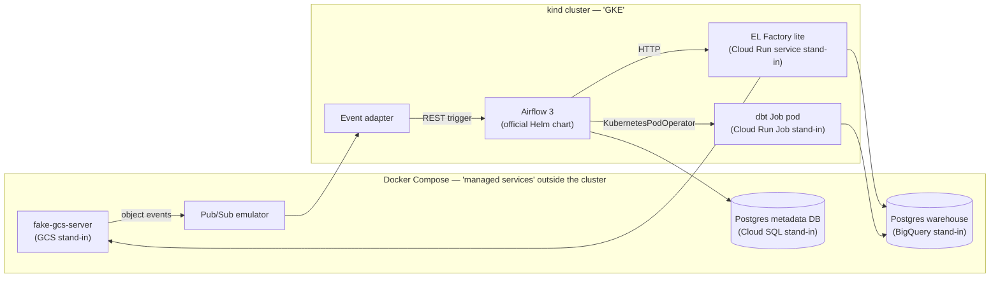

# PLAN — local Airflow-on-Kubernetes lab

Status of each phase lives in its heading line.
History of what was done lives in [`LEDGER.md`](LEDGER.md).

## 1. Goal

Become operationally fluent in self-managed Airflow on Kubernetes (Stage 2) while writing DAGs that move unchanged to Cloud Composer (Stage 3).
The lab reproduces the work platform's data flow end to end on one WSL2 machine:
trigger → Airflow DAG → EL Factory extraction → object storage staging → warehouse `ds_source` → readiness check → dbt medallion build → readiness record.

### Scope

In scope: containers, Kubernetes, Helm, the official Airflow chart, Airflow 3 DAG design, a Python extraction service, dbt, event-triggered runs, and day-2 operations (upgrades, scaling, observability, failure recovery).

Extras, deliberately deferred: Workload Identity, IAM, OIDC calls to Cloud Run, VPC/private networking, Cloud Logging/Monitoring.
They are learned on real GCP if Phase 7 is ever opened.

### What carries forward

| Carries to | Skills |
|---|---|
| Stages 2 and 3 | DAG design (mapping, pools, TaskGroups, deferrable tasks), hooks/operators, retry and idempotency design, container images, dbt project structure, DAG CI |
| Stage 2 only | Kubernetes, Helm, chart values, executor choice, KEDA, git-sync, metadata DB operations, failure drills |
| Needs translation | dbt SQL dialect (Postgres → BigQuery), DAG delivery (git-sync → Composer bucket), secrets backend, remote logging, event wiring |
| Real GCP only | Cloud Run / BigQuery operators against real services, GKE node pools, Composer environment management, the deferred extras above |

## 2. Architecture



### Stand-in map

| Production | Local stand-in | Fidelity |
|---|---|---|
| Cloud Scheduler | Airflow schedules | Exact: this is the replacement |
| Cloud Workflows | Airflow DAGs | Exact: this is the replacement |
| EL Factory on Cloud Run service | EL Factory lite Deployment + Service in kind | High: Airflow sees only HTTP |
| dbt on Cloud Run Job | Same dbt image launched by `KubernetesPodOperator` | Medium: same image and args, different launcher (hidden behind the seam) |
| GCS | fake-gcs-server (`STORAGE_EMULATOR_HOST`) | High: real `google-cloud-storage` client |
| Pub/Sub, Eventarc | Pub/Sub emulator + event adapter calling the Airflow REST API | Medium |
| BigQuery | Postgres + `dbt-postgres` | Medium: structure transfers, dialect does not |
| Cloud SQL (Airflow metadata) | Separate Postgres outside the cluster | High |
| Artifact Registry | kind local registry | High |

EL Factory lite runs inside kind only because Cloud Run has no local equivalent.
At work, EL Factory and dbt are expected to stay on Cloud Run; nothing in this lab assumes they move onto GKE.

## 3. Decisions

Each decision states its rationale; change the decision here before acting on a change.

| # | Decision | Rationale |
|---|---|---|
| D1 | **Airflow 3.3.1** | Newest version shipped by both Apache and Composer 3 (`composer-3-airflow-3.3.1-build.*`, Sep 2026); Airflow 3 is GA on Composer 3 since 2026-04-15. Composer's default is still 2.11.1, so starting on 3.x avoids learning a soon-legacy architecture. Re-check the Composer version list before bumping. |
| D2 | **Official `apache-airflow/airflow` Helm chart, 1.22.x**, image overridden to 3.3.1 | Upstream-maintained, Airflow 3-aware (api-server, standalone dag-processor, triggerer), what self-managed GKE would use. |
| D3 | **Provider pins track Composer's** (`apache-airflow-providers-google` 22.4.0 at time of writing) plus `cncf.kubernetes`, `http`, `postgres` | DAG code imports what Stage 3 will have. Look up current pins in the Composer preinstalled-packages changelog. |
| D4 | **kind** for the local cluster, Kubernetes minor within GKE's currently supported range: kind v0.33.0 with `kindest/node:v1.36.4` (digest-pinned in the `Makefile`), 1 control plane + 2 workers, local registry `registry:3` on `localhost:5001` | Reproducible from one config file, multi-node, used by Airflow's own chart tests. 1.36 is the GKE Regular-channel default as of 2026-10-08. Docker Desktop's built-in Kubernetes stays off. Toolchain pins (kind, helm 3.22.0, k9s 0.51.0) live in `scripts/install-tools.sh` with checksums. |
| D5 | **CeleryExecutor** as the primary executor; KubernetesExecutor explored in Phase 6 via Airflow 3 multi-executor config | Tasks are thin orchestration calls; Composer runs Celery workers, so this is the transferable model. |
| D6 | **External metadata DB** (Postgres in Compose), PgBouncer enabled in the chart | Mirrors Cloud SQL; the chart's bundled Postgres is dev-only. |
| D7 | **Workload seam**: business DAGs call `ElFactoryHook` and a `run_dbt(selection, ...)` task factory from a shared package; nothing else touches workloads | Lets Stage 2/3 swap `KubernetesPodOperator` → `CloudRunExecuteJobOperator` without editing DAGs. |
| D8 | **Postgres warehouse** with datasets as schemas: `ds_stage`, `ds_source`, `bronze`, `silver`, `gold`, `exposed`, `ops` (readiness ledger) | Mirrors work layer names; simplest dbt adapter. |
| D9 | **Data sources**: one deterministic synthetic source (repeatable, for idempotency tests) plus one public no-auth API | Clean-room data with realistic pagination and failure modes. |
| D10 | **DAG delivery**: kind host-path mount during Phases 3–4, git-sync from the GitHub remote from Phase 6 | Fast inner loop first, production-like delivery later. |
| D11 | **Fast DAG loop**: `dag.test()` + pytest (DagBag import test, unit tests on hooks) on the workstation; the cluster is for platform behaviour | Avoids a second, Compose-based Airflow. |
| D12 | **Tasks never touch the metadata DB directly** | Airflow 3 Task SDK model; Composer 3 workers have no DB access since 3.1.7-build.1. |

### EL Factory lite contract (initial; may evolve in Phase 1)

- `GET /catalog?pipeline=<name>` → enabled `[{source, entity}]` for a pipeline (EL Factory owns the catalog; DAGs never copy it).
- `POST /extract` with `{source, entity, run_id, interval_start, interval_end, cursor?}` → `{status, rows, next_url|null}`; the caller follows `next_url` until null.
- Writes staged files to `gs://staging/<source>/<entity>/<run_id>/…`, then loads `ds_source` idempotently per `(entity, interval, run_id)`.
- `GET /healthz` for probes.

### Readiness ledger (initial)

`ops.readiness(product, interval_start, interval_end, watermark, run_id, status, updated_at)`, written by the DAG after each dbt stage and read by consumer DAGs; independent of Airflow's own metadata.

## 4. Repository layout (target)

```
platform/
  compose/        # warehouse, metadata DB, fake-gcs, Pub/Sub emulator
  kind/           # cluster config, local registry
  helm/airflow/   # values.yaml (+ overlays per experiment)
services/
  el-factory/     # EL Factory lite (Flask + gunicorn)
  event-adapter/  # Pub/Sub → Airflow REST trigger
dbt/              # dbt project + Dockerfile
airflow/
  dags/           # business DAGs
  include/        # shared package: ElFactoryHook, run_dbt, readiness helpers
  Dockerfile      # Airflow image with pinned providers + include/
tests/
Makefile          # single entry point: up / down / build / deploy / test
```

## 5. Phases

Each phase ends on its exit criterion; a phase is done only when that check passes and a LEDGER entry records the evidence.

### Phase 0 — Toolchain and skeleton · Status: done

- Install `kind`, `helm` (≥ 3.19), `k9s`; confirm Docker Desktop WSL integration and its resource limits.
- Create the layout above, the Makefile skeleton, kind config with a local registry, `.gitignore`.
- **Exit:** `make cluster-up` creates a multi-node kind cluster with the registry reachable; `make cluster-down` removes it cleanly.

### Phase 1 — Workloads in containers · Status: not started

- Compose stack: warehouse Postgres, fake-gcs-server.
- EL Factory lite: Flask + gunicorn, non-root, multi-stage image, health check, config via env, the contract in §3.
- dbt project on `dbt-postgres`: sources on `ds_source`, models through `bronze` → `exposed`, tests, selectors per stage; its own image.
- **Exit:** a manual `curl` run lands files in fake-gcs and rows in `ds_source`; `docker run <dbt image> build --select <stage>` produces `gold`/`exposed`; re-running the same `run_id` leaves row counts unchanged.

### Phase 2 — Kubernetes with our own workloads · Status: not started

- Push images to the local registry; deploy EL Factory lite as Deployment + Service; run dbt as a Kubernetes Job.
- Learn by writing: ConfigMaps, Secrets, probes, requests/limits, ServiceAccounts, namespaces; connect the cluster to the Compose network.
- Break things on purpose: bad image tag, failing probe, OOMKill, missing Secret; diagnose each with `kubectl describe/logs/events`.
- **Exit:** the dbt Job completes from `kubectl apply`, EL Factory lite answers inside the cluster, and every manifest field is explainable.

### Phase 3 — Airflow via Helm · Status: not started

- Custom Airflow image (D1, D3) in the local registry; chart values in git (D2, D5, D6, D10); triggerer enabled; UI via port-forward.
- Metadata DB Postgres added to Compose.
- Practise `helm upgrade`, `helm rollback`, `helm diff`, and the DB-migration job.
- **Exit:** a hello DAG runs on a Celery worker; an upgrade followed by a rollback leaves the deployment healthy.

### Phase 4 — Port the scheduled ELT pipeline · Status: not started

- Build the workload seam (D7): `ElFactoryHook` (pagination, `run_id`, validation, result summary) and `run_dbt` (KubernetesPodOperator under the hood).
- DAG: resolve run context → `GET /catalog` → dynamically mapped extract tasks in pool `el_factory` (size 7) → readiness/watermark check → one `run_dbt` per stage → write `ops.readiness`.
- Decide and document the single retry owner across Airflow, EL Factory, and dbt (`dbt retry`).
- `catchup=False` unless a backfill policy exists; XCom carries identifiers only.
- **Exit:** a full run succeeds; clearing and re-running any task or the whole run duplicates no data; killing a mapped task mid-run recovers via retry.

### Phase 5 — Events and cross-pipeline dependencies · Status: not started

- Pub/Sub emulator in Compose; fake-gcs object notifications → topic; event adapter triggers a file-arrival DAG via the Airflow REST API with `{bucket, object, generation}` in `conf`.
- Consumer DAG that waits (deferrable) on `ops.readiness` for a producer's watermark, then runs its own dbt stage.
- Compare Airflow Assets for intra-deployment signalling against the durable ledger.
- **Exit:** dropping one file triggers exactly one scoped run; re-delivering the same event does not reprocess the same generation.

### Phase 6 — Operate it like production · Status: not started

- Observability: StatsD → Prometheus + Grafana; dashboards for scheduler heartbeat, queued tasks, pool usage, task durations.
- Scaling: KEDA for Celery workers; resource tuning; KubernetesExecutor experiment (D5) with a written comparison.
- Delivery: git-sync from the GitHub remote; GitHub Actions for lint, DagBag test, image builds, and an integration test on kind.
- Failure drills: kill the scheduler, drain a node, stop the metadata DB, starve a worker, roll the chart and Airflow minor version.
- **Exit:** every drill is detected from dashboards/logs and recovered via a written runbook entry.

### Phase 7 — Real GCP touchpoint · Status: parked

Opened only by explicit decision (personal GCP spend).
Candidate content: Artifact Registry + Cloud Run Job + BigQuery sandbox; switch the seam to `CloudRunExecuteJobOperator`/BigQuery; optionally a short-lived GKE Autopilot cluster with Workload Identity and `composer-local-dev` for a Composer rehearsal.

## 6. Risks and watch-items

- Composer may lag or drop Airflow builds; re-check D1/D3 before any version bump.
- Postgres SQL in dbt drifts from BigQuery idioms; keep models simple and note dialect-specific spots.
- WSL2 resource contention with Docker Desktop; keep the cluster to the nodes a phase needs.
