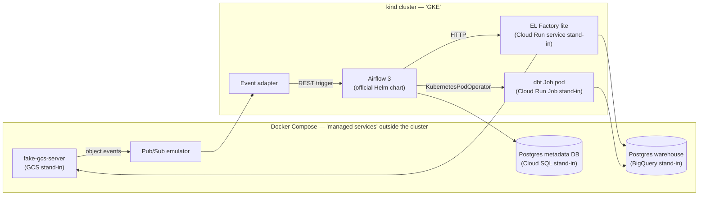

# PLAN — local Airflow-on-Kubernetes lab

Status of each phase lives in its heading line.
History of what was done lives in [`LEDGER.md`](LEDGER.md).

## 1. Goal

Become operationally fluent in self-managed Airflow on Kubernetes (Stage 2) while writing DAGs that move unchanged to Cloud Composer (Stage 3).
The lab reproduces the work platform's data flow end to end on one WSL2 machine:
trigger → Airflow DAG → EL Factory extraction → object storage staging → warehouse `ds_source` → readiness check → dbt medallion build → readiness record.

### Scope

In scope: containers, Kubernetes, Helm, the official Airflow chart, Airflow 3 DAG design, a Python extraction service, dbt, event-triggered runs, and day-2 operations (upgrades, scaling, observability, failure recovery).

Extras, deliberately deferred: Workload Identity, IAM, OIDC calls to Cloud Run, VPC/private networking, Cloud Logging/Monitoring.
They are learned on real GCP if Phase 7 is ever opened.

### What carries forward

| Carries to | Skills |
|---|---|
| Stages 2 and 3 | DAG design (mapping, pools, TaskGroups, deferrable tasks), hooks/operators, retry and idempotency design, container images, dbt project structure, DAG CI |
| Stage 2 only | Kubernetes, Helm, chart values, executor choice, KEDA, git-sync, metadata DB operations, failure drills |
| Needs translation | dbt SQL dialect (Postgres → BigQuery), DAG delivery (git-sync → Composer bucket), secrets backend, remote logging, event wiring |
| Real GCP only | Cloud Run / BigQuery operators against real services, GKE node pools, Composer environment management, the deferred extras above |

## 2. Architecture



### Stand-in map

| Production | Local stand-in | Fidelity |
|---|---|---|
| Cloud Scheduler | Airflow schedules | Exact: this is the replacement |
| Cloud Workflows | Airflow DAGs | Exact: this is the replacement |
| EL Factory on Cloud Run service | EL Factory lite Deployment + Service in kind | High: Airflow sees only HTTP |
| dbt on Cloud Run Job | Same dbt image launched by `KubernetesPodOperator` | Medium: same image and args, different launcher (hidden behind the seam) |
| GCS | fake-gcs-server (`STORAGE_EMULATOR_HOST`) | High: real `google-cloud-storage` client |
| Pub/Sub, Eventarc | Pub/Sub emulator + event adapter calling the Airflow REST API | Medium |
| BigQuery | Postgres + `dbt-postgres` | Medium: structure transfers, dialect does not |
| Cloud SQL (Airflow metadata) | Separate Postgres outside the cluster | High |
| Artifact Registry | kind local registry | High |

EL Factory lite runs inside kind only because Cloud Run has no local equivalent.
At work, EL Factory and dbt are expected to stay on Cloud Run; nothing in this lab assumes they move onto GKE.

## 3. Decisions

Each decision states its rationale; change the decision here before acting on a change.

| # | Decision | Rationale |
|---|---|---|
| D1 | **Airflow 3.3.1** | Newest version shipped by both Apache and Composer 3 (`composer-3-airflow-3.3.1-build.*`, Sep 2026); Airflow 3 is GA on Composer 3 since 2026-04-15. Composer's default is still 2.11.1, so starting on 3.x avoids learning a soon-legacy architecture. Re-check the Composer version list before bumping. |
| D2 | **Official `apache-airflow/airflow` Helm chart, 1.22.x**, image overridden to 3.3.1 | Upstream-maintained, Airflow 3-aware (api-server, standalone dag-processor, triggerer), what self-managed GKE would use. |
| D3 | **Provider pins track Composer's** (`apache-airflow-providers-google` 22.4.0 at time of writing) plus `cncf.kubernetes`, `http`, `postgres` | DAG code imports what Stage 3 will have. Look up current pins in the Composer preinstalled-packages changelog. |
| D4 | **kind** for the local cluster, Kubernetes minor within GKE's currently supported range: kind v0.33.0 with `kindest/node:v1.36.4` (digest-pinned in the `Makefile`), 1 control plane + 2 workers, local registry `registry:3` on `localhost:5001` | Reproducible from one config file, multi-node, used by Airflow's own chart tests. 1.36 is the GKE Regular-channel default as of 2026-10-08. Docker Desktop's built-in Kubernetes stays off. Toolchain pins (kind, helm 3.22.0, k9s 0.51.0) live in `scripts/install-tools.sh` with checksums. |
| D5 | **CeleryExecutor** as the primary executor; KubernetesExecutor explored in Phase 6 via Airflow 3 multi-executor config, as an opt-in overlay only (D25) | Tasks are thin orchestration calls; Composer runs Celery workers, so this is the transferable model. |
| D6 | **External metadata DB** (Postgres in Compose), PgBouncer enabled in the chart: two replicas, preferred anti-affinity across the nodes, PodDisruptionBudget `maxUnavailable: 1` | Mirrors Cloud SQL; the chart's bundled Postgres is dev-only. Every component reaches the DB through PgBouncer, so a single replica turned a node drain into a DB outage for all of them (issue #2). The anti-affinity is soft because two kind nodes leave no room for a rollout's surge pod or a drained replica under a hard rule. `max_prepared_statements = 100` (PgBouncer 1.21+) lets clients that cache named prepared statements, such as KEDA's PostgreSQL scaler (pgx), work in transaction pooling; without it most scaler polls failed with `prepared statement "stmtcache_…" already exists`. |
| D7 | **Workload seam**: business DAGs call `ElFactoryHook` and a `run_dbt(selection, ...)` task factory from a shared package; nothing else touches workloads | Lets Stage 2/3 swap `KubernetesPodOperator` → `CloudRunExecuteJobOperator` without editing DAGs. |
| D8 | **Postgres warehouse** with datasets as schemas: `ds_stage`, `ds_source`, `bronze`, `silver`, `gold`, `exposed`, `ops` (readiness ledger) | Mirrors work layer names; simplest dbt adapter. |
| D9 | **Data sources**: one deterministic synthetic source (repeatable, for idempotency tests) plus one public no-auth API; from Phase 8 also NYC TLC trip records, a public file-backed source (D34) | Clean-room data with realistic pagination and failure modes; TLC adds large files, a monthly cadence, publication lag and real schema drift. |
| D10 | **DAG delivery**: kind host-path mount during Phases 3–5; from Phase 6 git-sync of `main` from the GitHub remote is the default (D23), and the host-path mount survives only as a dev-loop overlay | Fast inner loop first, production-like delivery later. Phase checks run against git-sync, so they test what production does. |
| D11 | **Fast DAG loop**: `dag.test()` + pytest (DagBag import test, unit tests on hooks) on the workstation; the cluster is for platform behaviour | Avoids a second, Compose-based Airflow. |
| D12 | **Tasks never touch the metadata DB directly** | Airflow 3 Task SDK model; Composer 3 workers have no DB access since 3.1.7-build.1. |
| D13 | **Cluster ↔ Compose networking: kind nodes join the Compose network `pplk8s`**; pods use the Compose names (`warehouse`, `gcs`, `metadata-db`) | CoreDNS forwards non-cluster names to Docker's embedded DNS, so pods resolve the same names as Compose containers with no per-service Kubernetes objects. It also satisfies fake-gcs, which advertises `http://gcs:4443` for resumable uploads. Production reaches managed services by private IP/DNS in the same way. `platform/kind/join-services-network.sh` runs from both `cluster-up` and `services-up`, so start order does not matter. |
| D14 | **Namespaces: `workloads`** (EL Factory, dbt pods: the Cloud Run stand-ins) **and `airflow`** (the chart) | Mirrors the production split: workloads are not part of the Airflow deployment. Airflow's worker ServiceAccount gets a Role in `workloads` to launch dbt pods; DAGs reach EL Factory at `http://el-factory.workloads.svc.cluster.local`. |
| D15 | **Airflow is the single retry owner for transient faults.** EL Factory never retries internally; it classifies faults (503 `retryable: true` vs 4xx/502/500 non-retryable). `ElFactoryHook` makes one pass per task attempt: retryable → plain exception (task `retries` with exponential backoff apply), non-retryable → `AirflowFailException` (fail fast). dbt tasks retry by re-running `dbt build --select <stage>` in a fresh pod; `dbt retry` is not used | Retries never multiply across layers. Every extract attempt restarts at page 0, which clears the whole `(run_id, interval)`, so a retry after a failure on page N duplicates nothing. File-backed sources (D34) resume by chunk instead of restarting; Airflow stays the only retry owner. `dbt retry` needs the previous invocation's `target/run_results.json`, which dies with the ephemeral pod (the same holds on a Cloud Run Job); stage builds are idempotent, so a full stage re-run is safe. |
| D16 | **Image tags are immutable: bump the tag on every image change, in one place: the Makefile** (`AIRFLOW_IMAGE`, `ELF_IMAGE`, `ADAPTER_IMAGE`, `DBT_IMAGE`; issue #23). Airflow: `deploy.sh` passes it to the chart with `--set`. EL Factory and event adapter: their Deployments name placeholders (`el-factory`, `event-adapter`) that `workloads-up.sh` maps to the Makefile references with a throwaway Kustomize overlay (`images:`). dbt: `dbt-job.sh` fills the Job template from `DBT_IMAGE`, and `workloads-up.sh` and `deploy.sh` set the Airflow Variable `dbt_image`, which `run_dbt` reads at task run time with no default. Scripts run outside make read the Makefile default (`make -s print-<VAR>`) | kind nodes cache images by tag with `pullPolicy: IfNotPresent`, so a rebuilt image under the same tag never reaches running pods. One source per tag, because a bump that must touch several files is the step that gets missed: overriding `ELF_IMAGE` used to push the new tag and deploy the old one. dbt has no default tag in the seam, because a missing Variable should fail the task, not run a stale image; on Cloud Run the image belongs to the Job definition and the operator names only the Job. DAG files and `airflow/include/` reach pods through git-sync (D23) and need no rebuild; dependency changes (`requirements.txt`, `Dockerfile`) do. |
| D17 | **Events reach Airflow through an event adapter calling the REST API** (`services/event-adapter`, Pub/Sub streaming pull → `POST /api/v2/dags/{id}/dagRuns`); Airflow's `AssetWatcher` with the Pub/Sub `MessageQueueTrigger` runs beside it as a log-only spike for comparison | The adapter is the Eventarc stand-in: production wiring is GCS → Pub/Sub/Eventarc → a trigger call, and a REST trigger works the same on self-managed Airflow and Composer. An `AssetWatcher` puts a long-lived subscriber inside one deployment's triggerer; the spike measures what that buys and costs (see `docs/events.md`). |
| D18 | **Exactly-once is by idempotency, never by delivery.** The adapter derives a deterministic run id `gcs__<bucket>__<object-slug>__<generation>__<hash8>` (the slug is lossy, the hash of the exact `bucket/object` is not); a redelivery gets HTTP 409 and is acked. The file-arrival DAG checks the durable ledger `ops.file_loads(bucket, object, generation)` first and short-circuits if that generation is loaded, and writes it last. Ack on 2xx, 409, and non-retryable 4xx (logged as poison); nack on 5xx and connection errors | Pub/Sub delivers at least once. The run id dedupes while the run exists in the metadata DB; the ledger still dedupes after `airflow db clean` or a deleted run, and is independent of Airflow like `ops.readiness`. EL Factory reads exactly the event's generation, so an overwritten object can never load stale bytes. |
| D19 | **Cross-pipeline waits read `ops.readiness` through a deferrable sensor** (`pplk8s.sensors.ReadinessSensor` → `ReadinessTrigger` in the triggerer), not Airflow Assets | The ledger is shared with producers outside this deployment, carries the watermark, and survives a move to Composer; Assets live in one deployment's metadata DB. Deferring frees the worker slot for the whole wait. |
| D20 | **dbt selection by pipeline and layer.** Every model carries its pipeline tag (`sales`, `returns`, `finance`, `tlc`) next to its layer tag; `run_dbt(stage, pipeline=...)` builds `tag:<pipeline>,tag:<stage>` | One pipeline's stage never rebuilds another pipeline's models, so an event-triggered DAG and a scheduled one cannot overwrite each other's tables. The weather models stay in `sales` until a weather DAG exists, which keeps `sales_elt` building exactly what it built in Phase 4. **A model that reads another pipeline's model is a table, never a view** (`exp_net_sales_daily`), enforced at image build by `dbt/scripts/check_pipeline_views.py`: dbt-postgres rebuilds a relation by dropping the old one with `CASCADE`, so a `sales` gold or `returns` silver rebuild dropped finance's view until `finance_daily` next ran (issue #27). A table costs nothing here, because the consumer's own DAG rebuilds it after its readiness waits. BigQuery has no such dependency drop (`CREATE OR REPLACE TABLE` leaves views alone), so on the target a view stays an option; the rule is the stand-in's price. |
| D21 | **Observability: kube-prometheus-stack 92.3.0** (namespace `monitoring`: Prometheus, Alertmanager, Grafana, kube-state-metrics, node-exporter) **plus the chart's StatsD exporter, with InfluxDB-style tags** (`[metrics] statsd_influxdb_enabled = True`); scraping by `ServiceMonitor`/`PodMonitor`, dashboards and alert rules as code (`ConfigMap` with label `grafana_dashboard`, `PrometheusRule`); the metadata DB and warehouse are watched by a `postgres_exporter` in Compose, next to the databases | StatsD → Prometheus + Grafana is the self-managed GKE norm and the chart ships the exporter. Airflow 3.3 emits pool, `ti.<state>`, and `task.duration` metrics with tags only; plain StatsD drops the tags, so every pool would write one unlabelled series. The exporter beside the DB mirrors Cloud SQL's own monitoring, which sits outside GKE. OpenTelemetry (`otel_on`) is closer to where Airflow is heading but is one more component; noted, not built. Laptop trim: no etcd/controller-manager/scheduler/proxy scraping, 2-day retention. As built: the exporter's default naming already turns the tags into labels, so the chart's Airflow 2 mappings are replaced by two histogram mappings (task and run durations); a 5-minute cache TTL drops series of replaced pods. Prometheus keeps its TSDB on a 5Gi PVC (`retentionSize: 4GB`) and runs on the kind control plane: on the operator's default emptyDir, drill 2's drain wiped every series (issue #9), and kind's `local-path` PV is pinned to its node, so on a worker a drain would leave Prometheus Pending and blind for the drill it observes. The drills never drain the control plane; drill 2 restarts Prometheus and asserts a pre-drain sample survives. A shared host mount for a node-independent PV would mimic a GKE persistent disk more closely (it re-attaches on any node in the zone), but it needs a cluster rebuild and a WSL2 bind mount that can come up empty after a Docker restart (`ensure-dag-mount.sh`); not chosen. Two default rules are disabled because WSL2's clocks disagree: the monotonic clock runs ~6.5% slower than wall time, and Hyper-V TimeSync steps the wall clock forward ~2 s every ~32 s (issue #5). `AlertmanagerClusterCrashlooping` reads the creeping process start times as restarts, and `PrometheusMissingRuleEvaluations` fires for every rule group about every 4 minutes, because Prometheus ticks groups on the monotonic clock but counts missed slots on the wall clock. `PrometheusRuleGroupOverrun` (`manifests/prometheus-rules.yaml`) replaces the latter: a group evaluation that outlasts its interval is what makes a group miss slots, and durations are timed on the monotonic clock. On GKE, keep the default rule. |
| D22 | **Remote task logs on fake-gcs** (`gs://airflow-logs`, Airflow's GCS task handler, `STORAGE_EMULATOR_HOST` on the components that read or write logs), and **Celery workers without persistence** (a Deployment, no node-pinned log PVCs) | Composer's model (logs in the environment bucket). Without it KEDA scale-in deletes the worker that holds a finished task's log, KubernetesExecutor pods take their logs with them, and a drained node strands a StatefulSet worker whose `local-path` PV is pinned to it. If the emulator cannot back the handler, the fallback is worker persistence with KEDA `minReplicaCount` ≥ 2 and the drain limitation documented. As built: workers report their pod IP as hostname (`get_host_ip_address`), because a Deployment pod's name does not resolve and the api-server streams a running task's log from `<hostname>:8793`; an emulator-only logging config (`pplk8s.emulator_logging`) accepts fake-gcs's wording of a missing object, which the provider otherwise mistakes for a read failure and refuses to upload. |
| D23 | **git-sync** (chart `dags.gitSync`) **syncs `airflow/` from `main`** over SSH with a read-only deploy key; DAGs load from `<sync>/repo/airflow/dags`, and the shared package from `<sync>/repo/airflow/include` on `PYTHONPATH`, so DAGs and the seam always move together; the image carries only pinned dependencies (plus a baked copy of `include/` as a fallback for one-off pods). The private key lives outside the repo (`~/.ssh/pplk8s-deploy`) and reaches the cluster as Secret `airflow-git-ssh`, created once by `deploy.sh`; GitHub's host keys are pinned in `knownHosts`. A check refuses to run when the local `airflow/` differs from the commit git-sync serves | Syncing only `dags/` would let a DAG that needs a new seam function arrive before the image that has it (an import error on every component); syncing both mirrors Composer's `dags/` + `plugins/` bucket sync. A deploy key is least privilege and keeps the repo private; a token expires and has a wider blast radius. Airflow 3's native `GitDagBundle` (versioned bundles, each component clones through an Airflow connection) is the framework-native alternative; not chosen because Composer does not use it and the chart's git-sync is the documented self-managed path, but it is worth a spike if DAG versioning per run becomes a need. |
| D24 | **KEDA 2.21.0 scales the Celery workers** (`workers.celery.keda`): min 1, max 4, polling 5 s, cooldown 60 s, HPA scale-down stabilisation 120 s, `worker_concurrency = 4`, query through PgBouncer | KEDA 2.21 is the first release supporting Kubernetes 1.36. With the default concurrency of 16 the chart's query `ceil((running+queued)/16)` never exceeds 1 for the lab's task counts, so KEDA would never scale; 4 makes a burst visible. Min 1 keeps a warm worker for the thin orchestration tasks. Composer scales its workers itself from the same queued/running signal. As built: a 16-task burst scaled 1 → 4 workers in 23 s and back to 1 about 110 s after it ended; the query counts every running or queued task in queue `default`, whatever its executor. With a minimum above 0 the HPA scales on its own 15 s loop: `pollingInterval` only refreshes status and `cooldownPeriod` is ignored (KEDA warns on apply); the 120 s stabilisation window is the setting that matters. Scale-in during a running task (issue #3, `keda-check.sh`): the HPA removes the cheapest pod (`controller.kubernetes.io/pod-deletion-cost`), Celery's warm shutdown stops taking work and lets a running task finish inside `terminationGracePeriodSeconds`, and a task still running when it expires is SIGKILLed and failed by the scheduler at `task_instance_heartbeat_timeout` (about 2 minutes after the pod went). **Grace period stays 60 s**: Composer also ends in-flight tasks when it removes workers and relies on task retries, so a long grace only buys time on the lab while stalling rollouts and drains; every business task carries `retries ≥ 1` instead (enforced by `test_every_business_task_survives_a_lost_worker`), and long waits stay deferrable. The scaler queries through PgBouncer, which needs `max_prepared_statements` (D6), or the metric fails and the HPA freezes the worker count; `KedaScalerErrors` (D28, drill 7) now alerts on that. |
| D25 | **KubernetesExecutor is an experiment overlay** (`values-multi-executor.yaml`, `executor: CeleryExecutor,KubernetesExecutor`); one task opts in with `executor=`; Celery stays the only executor of the default deployment | D5 already chose Celery as Composer's model; turning on a second executor adds pod-launch RBAC and a pod template, and a task naming an executor the deployment lacks is an import error, so the experiment DAG exists only with the overlay. (The prep expected renamed executor metrics; 3.3.1 already labels them with `executor_class_name` with one executor.) Measurements and verdict: `docs/executors.md`. |
| D26 | **GitHub Actions: `ci.yaml`** on every push and PR (lint, unit and DagBag tests, `dbt parse`, build of every image) **and `integration.yaml`** on PRs to `main` and on demand (kind with the Makefile's node image, Compose services, workloads, Airflow, then a slim check: the hello DAG on a Celery worker and the Phase 5 event path); actions pinned by commit SHA; images are built, never pushed | Private-repo runners have 2 CPU / 8 GB / 14 GB disk and finite minutes; the full stack only just fits, so the 11-minute Phase 4 check stays local. Nothing outside the lab consumes the images, so a registry push would rehearse nothing. |
| D27 | **Python 3.11 and Composer `3.3.1-build.3` provider pins** in the Airflow image (`apache/airflow:3.3.1-python3.11`; cncf-kubernetes 10.21.1, postgres 7.0.2, common-sql 2.1.1, standard 1.18.0, fab 3.8.1, google 22.4.0, http 6.0.5, celery 3.23.1) | Composer Gen 3 runs Python 3.11.8 (Composer versions page, 2026-10-10); the lab ran 3.12 on an unverified assumption. Keeping the target's version line is a project principle; the constraint lines these pins supersede are dropped in the Dockerfile and `pip check` must pass. |
| D28 | **A drill counts as detected when a Prometheus alert fires, and as recovered when its runbook procedure brings a canary DAG run to success**; every drill has a `PrometheusRule` alert, a Grafana panel, and a `docs/runbook.md` entry, and `tests/e2e/phase6-check.sh` injects, waits for firing, recovers, waits for resolve, and runs the canary | Dashboards alone are not assertable, and this repo's phases are done when a check passes. Faults that self-heal faster than an alert's `for:` window (a killed pod) are simulated as sustained outages (scale to 0) for the assertion. As built: `make phase6-check` also runs the chart/minor roll drill (`phase6-upgrade-drill.sh`, on a throwaway database `airflow_drill`), so every drill is in the exit check. The roll's wrong way back (helm rollback onto a migrated schema) kept the old pods serving, so availability alerts never fired; it is detected by `AirflowMigrationJobFailed` (restarts of the still-running migration pod, since the chart's Job restarts in place) and `AirflowRolloutStuck` (more pods than the spec). `task_instance_heartbeat_timeout` is lowered to 120 s, so a task on a dead worker fails into its retry sooner. A failing KEDA scaler freezes the worker count without failing anything else (issue #7), so drill 7 breaks the worker trigger's query and `KedaScalerErrors` detects it from `keda_scaled_object_errors_total` (the per-trigger `keda_scaler_detail_errors_total` stayed at 0 through the PgBouncer prepared-statement clash); KEDA's ServiceMonitor lives in `platform/monitoring/manifests`, not the KEDA chart, so the scrape does not depend on deploy order, and `KedaMetricsMissing` fires when it is gone. |
| D29 | **The Celery broker stays the chart's Redis without persistence; a lost message is caught by `AirflowTasksStuckQueued` and recovered by clearing the task, `[scheduler] task_queued_timeout` stays 600 s, and the worker liveness probe is 30 s x 3** (runbook drill 8) | A broker restart drops only in-flight messages, and the metadata DB, not Redis, holds every task's state, so persistence buys little and the scheduler already requeues a stuck task after `task_queued_timeout`. The gap was detection: a lost message left a task `queued` for 11 minutes with no alert. Lowering the timeout instead would also requeue tasks that only wait for capacity, and the scheduler fails a task on its third stuck attempt (`num_stuck_in_queued_retries`, default 2). After a restart, a worker that had a task running used to take no new task until that task ended (Celery's `AsynPool.flush` forgets which processes are busy; fixed upstream in Celery 5.7) or block forever in kombu's BRPOP read on a dead socket and stop answering `inspect ping` (issue #15). Two settings fix it: `[celery_broker_transport_options] socket_timeout = 10` bounds the read, and `[celery] celery_config_options` points at `pplk8s.celery_config`, Airflow's default config plus a wrapper around `AsynPool.flush` that backports the 5.7 fix and switches itself off on Celery ≥ 5.7. The backport is a deliberate stopgap until the Airflow constraints reach Celery 5.7 (its 5.7.0b1 pre-release crashes the worker on the first ack after a reconnect); `worker_cancel_long_running_tasks_on_connection_loss` was rejected because it frees the slot by cancelling the running task. The shorter probe stays as the backstop for any other wedge; it restarts a worker in about 90 s instead of about 6 minutes, and the task it kills retries (D24). AOF persistence on a PVC is the alternative if lost messages ever matter more than the restart time; it would pin Redis to a node as the Prometheus volume does (D21). |
| D30 | **Metadata DB retention: the chart's `databaseCleanup` CronJob runs `airflow db clean` daily at 03:17 for rows older than 60 days, without archive tables; a run waits up to ~6 h for the metadata DB (`airflow db check --retry`) before cleaning, and a failed run alerts until a later run succeeds**; checked by `tests/e2e/db-cleanup-check.sh` (in `make phase6-check`) | Crashed schedulers, triggerers, and dag-processors leave their `job` row `running` forever (41 triggerer rows on 2026-10-12, from drill 9 and earlier crashes); assignment ignores them because it checks heartbeat age, but they grow without bound, as do runs, task instances, and the `log` table. `db clean` deletes `job` rows by `latest_heartbeat`, so a live component's row is never touched. 60 days is Composer 3's default database retention, which Composer runs itself at least daily; Composer documents the older maintenance DAG as obsolete on Gen 3. A maintenance DAG was not chosen because it would run `db clean` from a task, which D12 rules out (Composer 3 workers have no DB access); the chart's CronJob is the framework-native self-managed equivalent. Archive tables (`_airflow_deleted__*`) would only move the growth elsewhere; nothing reads purged rows. The lab host is off at 03:17 most nights, so the CronJob runs that slot as a catch-up when the cluster starts at boot, before the metadata DB in Compose is up; with the chart's `backoffLimit: 1` the run failed within two minutes (issue #62). Waiting for the DB keeps the catch-up, which is the only run a lab that sleeps at night gets; `startingDeadlineSeconds` was rejected because it would skip that slot, so the cleanup would rarely run at all. The wait is a `command` override that runs the chart's own `args` after the check, so the chart's cleanup command still comes from the chart. ~6 h covers a late `make services-up`, and a run that outlasts it fails and alerts. kube-prometheus-stack's `KubeJobFailed` fired for as long as a failed Job existed, and `failedJobsHistoryLimit: 1` keeps the last one, so one failed run pinned the alert past later successes until someone deleted the Job; it is replaced by a `KubeJobFailed` that drops a CronJob's failed Job once the CronJob's last success is newer than the Job's start. A `ttlSecondsAfterFinished` was rejected: it clears the alert on a timer whether or not the cleanup ever recovered. |
| D31 | **Two schedulers and two triggerers, each with a PodDisruptionBudget `maxUnavailable: 1` and the chart's default preferred anti-affinity; the dag-processor and api-server stay at one replica.** A degraded-HA alert per role (`AirflowSchedulerDegraded`, `AirflowTriggererDegraded`) compares live jobs in the metadata DB with the Deployment's desired replicas; the live count comes from `sql_exporter` 0.24.9 beside the metadata DB (`airflow_jobs_alive`), and the "no heartbeat at all" alerts stay (runbook drills 1, 2, 9; issue #20) | Composer recommends two schedulers for most environments (1–3 allowed; more than three often lowers performance) and runs at least two triggerers in highly resilient environments (0–10 allowed); its preset table does not publish per-preset counts, so the recommendation, not a preset, sets the number. Airflow 3.3's HA scheduler needs only row-level locks (`SELECT ... FOR UPDATE`, `NOWAIT`/`SKIP LOCKED`; Postgres 12+); the locks live inside one transaction, so PgBouncer's transaction pooling (D6) carries them, and drill 1 found no lock errors and no task run twice. A trigger belongs to one triggerer job and moves only once that job ended or its heartbeat is 30 s stale, so a second triggerer turns an outage into a 23–24 s pause. The statsd heartbeat counters have no hostname tag and are summed over replicas, so they tell "none" from "some" but not "one of two"; `kube_deployment_status_replicas_available` misses a hung process (its pod stays Running); a job row with a fresh heartbeat is Airflow's own liveness rule. `sql_exporter` instead of postgres_exporter's custom queries, which are deprecated. The PDBs keep a drain from evicting both replicas at once; the scheduler's startup probe (`airflow jobs check`) keeps a new pod un-Ready until its job heartbeats, while the triggerer has no startup probe in chart 1.22, so its PDB counts a pod that may not heartbeat yet (drill 2 samples the live count instead and found at least one of each throughout). Anti-affinity stays preferred for the reason in D6, and pods do not move back after a drain, so both replicas can end up on one node until they are replaced. Losing the dag-processor or api-server stops no running work (parsing pauses; the UI and REST trigger pause), and each would cost another ~640 or ~384 Mi request. Measured on the laptop (2026-10-12): a second scheduler averaged ~240 MiB working set (peak ~380 MiB) and a second triggerer ~300 MiB (peak ~500 MiB); requests grew by 960 Mi; host memory in use went from 13.1 to 13.7 GiB, leaving 18.2 GiB available. The CI integration check runs one of each (`values-ci.yaml`): on the 2-vCPU runner two of each starved every probe and helm timed out; HA is proven by the local drills, not CI. |
| D32 | **Every `ops.readiness` row names the Airflow DAG run that wrote it (`dag_id`, `run_id`); `AirflowMetadataBehindWarehouse` fires for a run that wrote rows in the last 7 days but is unknown to the metadata DB**, from two `sql_exporter`s (the metadata DB's, now also exporting `airflow_dag_run_known{dag_id, run_id}` for runs of the last 8 days, and a new one beside the warehouse exporting `ops_readiness_updated_timestamp_seconds{product, dag_id, run_id}`), joined in PromQL on `(dag_id, run_id)` (runbook drill 10, issue #21) | A metadata DB restore (Cloud SQL backup or point-in-time recovery, a Composer snapshot load) rolls Airflow's history back while the warehouse keeps every row written since, and nothing else notices: the restored Airflow is healthy by every other signal. The readiness ledger is where the two histories meet, because every business run writes it, so a row whose run Airflow does not know is the drift itself, not a proxy for it. Run ids are unique only per DAG, and the checks write stand-in rows that no Airflow run produced (a non-Airflow producer is legitimate, D19), so `run_id` alone cannot be matched; `dag_id` is NULL for every producer other than this Airflow and those rows are not exported. Rejected: alerting on the metadata DB going backwards (max `dag_run.id` falling), which detects the restore but not which runs it lost, and clears as ids grow back; a documented check only, which breaks D28. The join lives in Prometheus because the two databases are separate servers (as Cloud SQL and BigQuery are); a cross-database query or a reconcile DAG would need a link between them or metadata DB access from a task, which D12 rules out. The windows keep the label sets small (~400 runs, a few dozen rows on the lab) and well inside `db clean`'s 60 days (D30), so retention never makes a row look orphaned. The alert is guarded on the metadata DB exporter answering, so a metadata DB outage stays `MetadataDBDown` alone, while a restore onto an empty database still fires. As built (drill 10, `tests/e2e/metadata-restore-drill.sh`): an in-place restore lost three runs and fired the alert once per run 80 s after Airflow came back; a redelivered event re-created its run under the same id and short-circuited on `ops.file_loads`; `scripts/metadata-reconcile.sh --replay` re-creates the rest one at a time in the order they finished (manual and event runs under their own ids, a scheduled run as a manual run for its interval) and the warehouse hashed the same throughout. Replays are sequential because a replayed consumer finds its producers' rows still `ready` and would build first; replayed together, `sales_elt`'s gold rebuild also cascade-dropped finance's view (issue #27). |
| D33 | **Probes are sized for a CPU-contended node: the scheduler's startup and liveness probes curl its own health server (`[scheduler] enable_health_check`, `:8974/health`) instead of running `airflow jobs check`; the exec probes that remain (triggerer, dag-processor, worker `celery inspect ping`) get `timeoutSeconds` up to their period (60, 60, 30 s); the api-server's and scheduler's startup budgets are 30 x 10 s; the worker's first ping waits 60 s.** Periods and failure thresholds are unchanged, so a hang is detected as fast as before (drill 1b: `/health` 503 after 26 s, the kubelet restarted the SIGSTOPped scheduler after 290 s) | Under contention a container gets CPU in proportion to its request, and each exec probe boots the Airflow CLI (~1.8 CPU-seconds, measured), so the triggerer's 100m request alone stretched a probe to ~18 s of its 20 s timeout. That is the CI flake (issue #30), and it is what a GKE node packed by requests does during a node upgrade, a drain, or a cold start. Reproduced by capping the kind worker nodes with `docker update --cpus` and deleting every Airflow pod at once: at 0.5 vCPU per node the chart's probes timed out everywhere and the api-server restarted twice before binding (222 s to Ready); with these probes, no exec probe failed and nothing restarted (171-172 s, three runs). The scheduler's health server filters on this host's job, as `jobs check --local` does, and runs in a child process, so a hung scheduler still answers 503 for 7 ms of CPU. The triggerer and dag-processor have no health server in 3.3, so they keep the CLI with more time; raising their CPU requests instead would reserve ~3x their measured idle use (50-100m) to pay for probes. `values-ci.yaml` keeps one scheduler and one triggerer (D31). |
| D34 | **EL Factory time-boxes every `/extract` request and resumes file sources by chunk.** Each request works until `MAX_RUN_TIME` (lab default 45 s, all sources) and answers `next_url` while work remains; `ElFactoryHook` loops the continuations inside one task attempt, with `MAX_RUN_TIME` below its read timeout and `execution_timeout` sized per entity. File sources (TLC) read by HTTP byte range and stage and load one chunk per step, recorded in `ops.file_chunks(source_uri, etag, chunk, rows, loaded_at)`; a request without a cursor continues after the chunks already loaded for that `etag`, a new `etag` starts over, and the last chunk writes `ops.file_versions(source_uri, etag, completed_at)`. Landing tables take every published column under its lower-cased name and evolve additively and by widening only (int → bigint → double); any other type change fails the load as non-retryable. Publication is asked of EL Factory (`GET /publication`), which classifies the source's 403: S3 `AccessDenied` = not published, a CloudFront block = 503 retryable (issues #37, #38) | This is the work platform's contract (`MAX_RUN_TIME` + `next_url`, 10 min there), so there are no hour-long requests and no async job API to wait on. Chunk resume makes the time box worth having: a retry redoes at most one chunk instead of a 500 MB file, while Airflow keeps owning the loop and the retries (D15) and EL Factory keeps no state outside the warehouse. Lower-casing, additive columns and widening are what a BigQuery load job allows (`ALLOW_FIELD_ADDITION`, `ALLOW_FIELD_RELAXATION`, case-insensitive names), so drift fails here exactly where it would fail there. Deferrable continuations (the triggerer awaiting each request) free the worker slot but need a custom trigger; recorded as a GKE/Composer design choice, not built. |
| D35 | **`tlc_monthly` runs `@monthly` with the data month as its interval, `catchup=True` from a fixed `start_date`, `max_active_runs=3`; each run waits deferrably for publication** (`PublicationSensor` → trigger polling EL Factory every few hours, 120-day timeout, then a missing-month alert); older months come only through Airflow 3's backfill (`airflow backfill create`). Scope: yellow + green, the latest 3 published months on the schedule, the drift months 2023-12, 2024-01, 2024-12, 2025-01 and 2026-06 backfilled on purpose; FHVHV is a catalog entry with `enabled: false` for the big-file drill only; ceilings: warehouse ≤ 15 GB, EL Factory ≤ 1 GiB memory (issues #38, #39) | The logical date names the data month, so backfills, readiness rows and the run list read naturally, and runs stay open for the 1–3 month publication lag. Catchup is the only option where a month boundary passed while the laptop was off heals itself; the backfill API is the same on Composer 3. The scope keeps every known drift seam under test for the least volume; the memory ceiling forces streaming instead of whole-file reads. |
| D36 | **TLC dbt models replace one data month at a time.** Bronze: one view per trip type casting to canonical names and types and filling NULL for columns a month predates. Silver `slv_tlc_trips` (yellow ∪ green), `slv_tlc_trips_quarantine` and gold are `incremental`, `delete+insert` on `data_month`, built for `--vars '{data_month: YYYY-MM}'` (`run_dbt(..., vars=)`); silver reads only the latest completed `(source_uri, etag)` of the month (`ops.file_versions`). Quarantine rules: negative fare or total, pickup outside the month, dropoff before pickup, trips over 24 h; a test warns above 2 % quarantined and errors above 10 %. Zones are a dbt seed. Readiness products `tlc.<stage>`, one row per month, watermark = month end (issue #40) | TLC rows have no natural key, so dedup is by file version, and a republished file replaces its month whole while a half-loaded version stays invisible. Quarantining instead of dropping keeps bad rows countable. On BigQuery the same models use `insert_overwrite` with a month-partitioned `pickup_date` and static partitions. |

### EL Factory lite contract (as built in Phase 1)

- `GET /catalog?pipeline=<name>` → enabled `[{source, entity}]` for a pipeline (EL Factory owns the catalog; DAGs never copy it); entries marked `enabled: false` are left out.
- `POST /extract` with `{source, entity, run_id, interval_start, interval_end, cursor?}` → `{status, rows, next_url|null}` plus informational `source, entity, page, pages, object`; the caller POSTs the same body to `next_url` (which carries `?cursor=`) until it is null. Since Phase 8 each request loads pages until `MAX_RUN_TIME` (45 s) is spent, then answers `next_url` for the rest (D34); gunicorn runs threaded workers so a long request neither hits the 30 s worker timeout nor blocks `/healthz`.
- Writes staged files to `gs://staging/<source>/<entity>/<run_id>/page-<NNNNN>.jsonl`, then loads `ds_source` from the staged object idempotently per `(entity, interval, run_id)`: each page replaces itself, and page 0 clears the whole run and interval.
- Errors are JSON with a `retryable` flag: 400/404 for bad requests, 503 retryable for transient source, warehouse, or GCS faults, 502 non-retryable when a source rejects the request, 500 otherwise. `FAIL_RATE` injects retryable 503s for the Phase 4 retry drills.
- `ds_source` tables are created by EL Factory (at startup and before each load); their column contract is in `services/el-factory/README.md` and is what the dbt sources read.
- File sources (`tlc`, Phase 8, D34): `POST /extract` with a one-month interval reads `<entity>_tripdata_<YYYY-MM>.parquet` by HTTP range, one Parquet row group per chunk, resuming after the chunks `ops.file_chunks` holds for the file's `etag`; the response adds `source_uri, etag, chunks`; an unpublished file is 502 with `published: false`, a CDN block a retryable 503, an incompatible column retype a non-retryable 502.
- `POST /load` with `{entity, bucket, object, generation, run_id}` (added in Phase 5) loads one landed NDJSON file at exactly that generation into `ds_source.<entity>`, replacing the object's earlier rows; a malformed file is 422, a superseded generation is 409 with `superseded: true` (non-retryable; the caller skips).
- `GET /healthz` for probes.

### Readiness ledger (initial)

`ops.readiness(product, interval_start, interval_end, watermark, run_id, status, updated_at, dag_id)`, written by the DAG after each dbt stage and read by consumer DAGs; independent of Airflow's own metadata, and matched against it by `(dag_id, run_id)` (D32).

## 4. Repository layout

```
.github/workflows/ # ci (lint, tests, image builds), integration (kind, slim e2e)
platform/
  compose/        # warehouse, metadata DB, fake-gcs, Pub/Sub emulator, database exporters
  kind/           # cluster config, local registry
  k8s/            # workloads namespace (Kustomize), dbt Job template
  helm/airflow/   # values.yaml (+ overlays: local DAGs, multi-executor)
  monitoring/     # kube-prometheus-stack values, scrape targets, alert rules, Grafana dashboard
  keda/           # KEDA operator values
services/
  el-factory/     # EL Factory lite (Flask + gunicorn)
  event-adapter/  # Pub/Sub → Airflow REST trigger
dbt/              # dbt project + Dockerfile
airflow/
  dags/           # business DAGs
  include/        # shared package: ElFactoryHook, run_dbt, readiness helpers
  Dockerfile      # Airflow image with pinned providers + include/
tests/e2e/        # one exit check per phase
docs/             # runbook of failure drills, event path, executor comparison
scripts/          # toolchain install, local helpers
Makefile          # single entry point: up / down / build / deploy / test
```

## 5. Phases

Each phase ends on its exit criterion; a phase is done only when that check passes and a LEDGER entry records the evidence.

### Phase 0 — Toolchain and skeleton · Status: done

- Install `kind`, `helm` (≥ 3.19), `k9s`; confirm Docker Desktop WSL integration and its resource limits.
- Create the layout above, the Makefile skeleton, kind config with a local registry, `.gitignore`.
- **Exit:** `make cluster-up` creates a multi-node kind cluster with the registry reachable; `make cluster-down` removes it cleanly.

### Phase 1 — Workloads in containers · Status: done

- Compose stack: warehouse Postgres, fake-gcs-server.
- EL Factory lite: Flask + gunicorn, non-root, multi-stage image, health check, config via env, the contract in §3.
- dbt project on `dbt-postgres`: sources on `ds_source`, models through `bronze` → `exposed`, tests, selectors per stage; its own image.
- **Exit:** a manual `curl` run lands files in fake-gcs and rows in `ds_source`; `docker run <dbt image> build --select <stage>` produces `gold`/`exposed`; re-running the same `run_id` leaves row counts unchanged.

### Phase 2 — Kubernetes with our own workloads · Status: done

- Push images to the local registry; deploy EL Factory lite as Deployment + Service; run dbt as a Kubernetes Job.
- Learn by writing: ConfigMaps, Secrets, probes, requests/limits, ServiceAccounts, namespaces; connect the cluster to the Compose network.
- Break things on purpose: bad image tag, failing probe, OOMKill, missing Secret; diagnose each with `kubectl describe/logs/events`.
- **Exit:** the dbt Job completes from `kubectl apply`, EL Factory lite answers inside the cluster, and every manifest field is explainable.

### Phase 3 — Airflow via Helm · Status: done

- Custom Airflow image (D1, D3) in the local registry; chart values in git (D2, D5, D6, D10); triggerer enabled; UI via port-forward.
- Metadata DB Postgres added to Compose.
- Practise `helm upgrade`, `helm rollback`, `helm diff`, and the DB-migration job.
- **Exit:** a hello DAG runs on a Celery worker; an upgrade followed by a rollback leaves the deployment healthy.

### Phase 4 — Port the scheduled ELT pipeline · Status: done

- Build the workload seam (D7): `ElFactoryHook` (pagination, `run_id`, validation, result summary) and `run_dbt` (KubernetesPodOperator under the hood).
- DAG: resolve run context → `GET /catalog` → dynamically mapped extract tasks in pool `el_factory` (size 7) → readiness/watermark check → one `run_dbt` per stage → write `ops.readiness`.
- Decide and document the single retry owner across Airflow, EL Factory, and dbt (`dbt retry`): decided as D15.
- `catchup=False` unless a backfill policy exists; XCom carries identifiers only.
- **Exit:** a full run succeeds; clearing and re-running any task or the whole run duplicates no data; killing a mapped task mid-run recovers via retry.

### Phase 5 — Events and cross-pipeline dependencies · Status: done

- Pub/Sub emulator in Compose; fake-gcs object notifications → topic; event adapter triggers a file-arrival DAG via the Airflow REST API with `{bucket, object, generation}` in `conf`.
- Consumer DAG that waits (deferrable) on `ops.readiness` for a producer's watermark, then runs its own dbt stage.
- Compare Airflow Assets for intra-deployment signalling against the durable ledger.
- **Exit:** dropping one file triggers exactly one scoped run; re-delivering the same event does not reprocess the same generation.

### Phase 6 — Operate it like production · Status: done

- Observability: StatsD → Prometheus + Grafana; dashboards for scheduler heartbeat, queued tasks, pool usage, task durations.
- Scaling: KEDA for Celery workers; resource tuning; KubernetesExecutor experiment (D5) with a written comparison.
- Delivery: git-sync from the GitHub remote; GitHub Actions for lint, DagBag test, image builds, and an integration test on kind.
- Failure drills: lose one of two schedulers (crash, hang, all), drain a node, stop the metadata DB, starve a worker, roll the chart and Airflow minor version, restart the Celery broker, lose one of two triggerers under a deferred wait, restore the metadata DB to an earlier point.
- **Exit:** every drill is detected from dashboards/logs and recovered via a written runbook entry.

### Phase 8 — A monthly file pipeline: NYC TLC trips · Status: planned

- EL Factory: time-boxed requests for every source, a TLC file source that streams by byte range and resumes by chunk, a publication probe (D34).
- dbt: the `tlc` models from bronze to exposed, month by month, with quarantine and a zone seed (D36).
- Airflow: `tlc_monthly` with catchup, a deferrable publication wait, and backfills of the drift months (D35).
- Drills: a mid-file failure resumes from the last chunk; an unpublished month waits, then alerts; a large month stays under EL Factory's memory ceiling.
- Build issues: sliced from [Slice the TLC design into build issues](https://github.com/Paradiddle131/pplk8s/issues/41).
- **Exit:** for the scheduled months and every drift month, `ops.readiness` holds `tlc.exposed` and each layer's monthly row counts reconcile (bronze = silver + quarantine); a republished file replaces its month; each drill is detected and recovered via a runbook entry.

### Phase 7 — Real GCP touchpoint · Status: parked

Opened only by explicit decision (personal GCP spend).
Candidate content: Artifact Registry + Cloud Run Job + BigQuery sandbox; switch the seam to `CloudRunExecuteJobOperator`/BigQuery; optionally a short-lived GKE Autopilot cluster with Workload Identity and `composer-local-dev` for a Composer rehearsal.

## 6. Risks and watch-items

- Composer may lag or drop Airflow builds; re-check D1/D3 before any version bump.
- Postgres SQL in dbt drifts from BigQuery idioms; keep models simple and note dialect-specific spots.
- WSL2 resource contention with Docker Desktop; keep the cluster to the nodes a phase needs.
