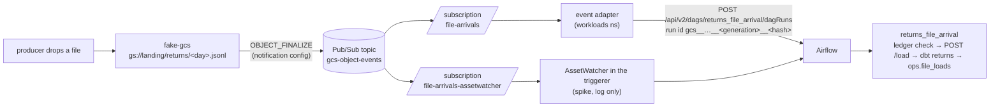

# Events and cross-pipeline dependencies (Phase 5)

This page explains how a landed file becomes exactly one Airflow run, and how one pipeline waits for another.
Decisions D17–D20 in [`PLAN.md`](../PLAN.md) are the short form; this page shows the mechanics and what was observed on the cluster.

## Event path



- fake-gcs publishes the same notification real GCS sends: attributes `bucketId`, `objectId`, `objectGeneration`, `eventType`, `eventTime`, `payloadFormat`, and the object resource as data.
- The Pub/Sub emulator keeps topics and subscriptions in memory; Compose's one-shot `pubsub-init` recreates them on every `make services-up`, before fake-gcs starts.
- The adapter (`services/event-adapter`) routes by bucket and object prefix (`routes.yaml` in ConfigMap `event-adapter-config`) and passes `{bucket, object, generation}` as the run's `conf`.
- The file-arrival DAG reads exactly that generation through EL Factory `POST /load`, so a run never loads bytes other than the ones its event announced.

## Exactly once, by idempotency (D18)

Pub/Sub delivers at least once, so the design never relies on delivery; every layer is safe to repeat.

| What happens | Which layer absorbs it | Result |
|---|---|---|
| The same event is delivered twice while its run exists | Deterministic run id; Airflow answers 409 | The adapter logs `duplicate` and acks; no second run |
| The run was deleted (or removed by `airflow db clean`) and the event comes again | `ops.file_loads` checked by `not_loaded_yet` | A new run starts and skips everything after the check |
| The object is overwritten before its first run loads it | EL Factory reads `?generation=`; the old generation is 404 → 409 `superseded` | The old run skips; the new generation has its own event and run |
| An old generation's load commits after a newer one | `replace_file` refuses an older generation under the per-object lock | The newer rows stay |
| Airflow is down, or the DAG is not parsed yet (404) | The adapter nacks | Pub/Sub redelivers after the ack deadline |
| The event can never succeed (other 4xx) | The adapter acks and logs `rejected` at ERROR | Nothing retries forever |

`ops.file_loads` is written as the last task, so a generation counts as loaded only once its whole run succeeded.
A failed run can therefore be cleared and re-run, or simply re-delivered after its run is deleted.

## Adapter or AssetWatcher (D17)

Both paths ran side by side on 2026-10-10 against the same topic, each on its own subscription.

| | Event adapter + REST trigger | `AssetWatcher` + `MessageQueueTrigger(scheme="google+pubsub")` |
|---|---|---|
| Runs per file | One run per object generation, named after it | One run per **pull**: one asset event carried three messages (a probe object and two generations of one file) and started one run |
| Routing | Bucket and prefix routes in config; unrouted events are acked and logged | None: every message on the subscription reaches the DAG, which must filter itself |
| Dedupe key | The run id; Airflow enforces it (409) | None built in; the DAG would need its own ledger check per message |
| Ack timing | After Airflow accepted or rejected the run | `ack_messages=True` acks on pull, before the asset event and run exist; `False` redelivers after the ack deadline and creates duplicate asset events |
| Delivery mechanics | Streaming pull, push-like latency | Polling every `poke_interval` (5 s here), a log line per empty pull |
| Where it lives | A separate workload; can trigger any Airflow, including Composer, over HTTP | Inside one deployment's triggerer; a second deployment needs its own subscription |
| Emulator setup | `PUBSUB_EMULATOR_HOST` on the adapter | `PUBSUB_EMULATOR_HOST` on the triggerer plus a Google connection with `is_anonymous: true`, because the hook resolves credentials before building the client |

The adapter stays the production path: it keeps "one file, one run", gives Airflow a dedupe key, and acks only after the run exists.
The AssetWatcher is attractive when events are many and tiny and a batch per run is acceptable, or when no separate service may be deployed.

## Waiting for another pipeline (D19)

`finance_daily` builds `exposed.net_sales_daily` from `sales` gold and `returns` silver.
It waits on the ledger, not on DAG ids or Assets:

```python
ReadinessSensor(task_id="wait_sales_gold", product="sales.gold",
                interval_start=ctx["interval_start"], interval_end=ctx["interval_end"])
```

The sensor checks once on the worker, then defers to `ReadinessTrigger`, which polls `ops.readiness` from the triggerer; the task holds no worker slot while it waits.
`timeout` bounds the whole wait.

### Assets or the ledger

| | `ops.readiness` (chosen) | Airflow Assets (`outlets` / `schedule=[asset]`) |
|---|---|---|
| Producers | Anything that can write a row: Airflow, a Cloud Run Job, a manual backfill | Airflow tasks in the same deployment (or the REST API) |
| What is recorded | Product, interval, watermark, run id, status | That an asset was updated, with optional `extra` |
| Survives | A metadata DB reset, a second Airflow, the move to Composer | Lives in one deployment's metadata DB |
| Consumer semantics | "Is my interval ready?": explicit, per interval, re-checkable | "Something was updated since my last run": queued events, no interval matching |
| Cost | A sensor per dependency, a trigger polling the warehouse | Free inside one deployment |

Assets fit signalling inside one deployment where any update should start the next DAG.
The ledger fits the platform being mimicked, where hand-offs cross tools and environments and consumers need a specific interval.
